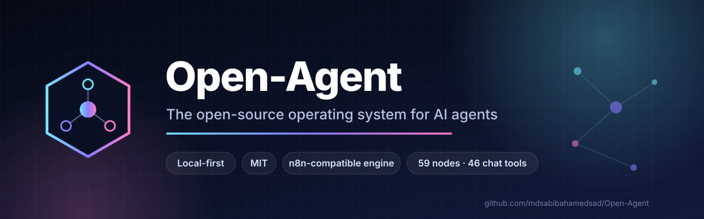
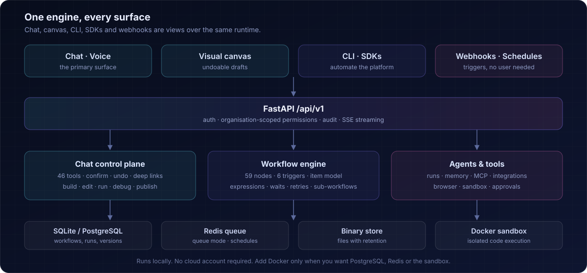

<div align="center">
  
</div>

<h1 align="center">Open-Agent</h1>

<p align="center">
  <b>Describe the automation. Watch it become a workflow.</b><br>
  Local-first automation with an n8n-style engine, AI agents, MCP tools,<br>
  and one chat box that builds, runs, debugs and publishes everything.
</p>

<p align="center">
  <a href="https://github.com/mdsabibahamedsad/Open-Agent/stargazers">
    
  </a>
  <a href="https://github.com/mdsabibahamedsad/Open-Agent/network/members">
    
  </a>
  <a href="LICENSE">
    
  </a>
  <a href="https://github.com/mdsabibahamedsad/Open-Agent/actions/workflows/ci.yml">
    
  </a>
</p>

<p align="center">
  
  
  
  
</p>

<p align="center">
  <a href="#quick-start"><b>Quick start</b></a> ·
  <a href="docs/">Docs</a> ·
  <a href="ARCHITECTURE.md">Architecture</a> ·
  <a href="ROADMAP.md">Roadmap</a> ·
  <a href="https://github.com/mdsabibahamedsad/Open-Agent/discussions">Discussions</a> ·
  <a href="https://github.com/mdsabibahamedsad/Open-Agent/issues?q=is%3Aissue+is%3Aopen+label%3A%22good+first+issue%22">Good first issues</a>
</p>

---

> ### ⭐ Star Open-Agent
>
> If you want automation that runs on **your** machine — no cloud account, no
> per-task pricing, no lock-in — **star this repo**. It takes one click, and it
> is how the next person looking for an open alternative finds us.
>
> [**Star Open-Agent →**](https://github.com/mdsabibahamedsad/Open-Agent/stargazers)

## Why Open-Agent?

| | |
| --- | --- |
| **Chat is the product** | Build, edit, run, debug, publish, restore and inspect from one conversation. 46 typed tools, confirmations for destructive actions, and undo through version history. The canvas is a view, not a separate workflow. |
| **Local-first by default** | `pnpm dev` gives you the whole stack on SQLite with no Docker, no PostgreSQL, no Redis and no account. Add Ollama and it works offline. Cloud providers are optional, not required. |
| **A real engine, not a demo** | 59 nodes, 6 triggers, n8n-style expressions, the `{ json, binary, pairedItem }` item model, retries, error workflows, binary data, sub-workflows, waits, queue mode and execution metrics. |
| **Yours to keep** | MIT licensed. Credentials encrypted at rest. Organisation-scoped permissions and audit logs. Every run is persisted and inspectable. |

## See it in action

```text
You  › Build a workflow: webhook → summarize with my local model → post to Slack

Koro › Built "Webhook → AI → Slack" · 3 nodes · 2 connections · draft v1
       [Open in builder]  [Run it]

You  › run it

Koro › ✓ Completed in 1.2s · 3/3 steps · [View run]

You  › publish it

Koro › Published · POST /api/v1/hooks/<path> · [Open workflow]
```

No page hopping, no separate builder session. The same conversation can inspect
the last failure, restore a previous version, list credentials, change a
schedule, or answer "which node broke and why?".

## What you get

| Area | What is implemented |
| --- | --- |
| **Chat control plane** | 46 tools behind one registry: build/edit, add/update/remove/connect nodes, run, retry, cancel, publish, versions, restore, undo, export/import, test a node, node logs, schedule, variables, credentials, agents, prune, health, coverage and `open_page` |
| **Workflow engine** | 59 nodes and 6 triggers, versioned definitions, typed ports, expressions, per-node retries, `onError`, timeouts, `executeOnce`, disabled passthrough, pinned data and partial execution |
| **Data model** | n8n-style items (`json`, `binary`, `pairedItem`), `run_mode: each/all`, merge fan-in (`append`, `by_index`, `by_key`), binary store with retention |
| **Durability** | Long waits resumed by the scheduler, webhook resume, sub-workflows with a parent/child execution tree, cancellation cascade, error workflows, static data |
| **Operations** | Per-workflow concurrency, execution budgets, retention pruning, webhook rate limits and body caps, queue mode with a worker entry point, crash journal, Prometheus `/metrics` |
| **AI** | Agents, tools, MCP servers, scoped memory, multi-agent teams, browser automation, sandboxed Python/JS code node, evaluations and human approvals |
| **Interfaces** | Chat-first web app, visual canvas with NDV, workflow chat pages, CLI, TypeScript/Python SDKs, REST API, webhooks and schedules |
| **Security** | Encrypted credentials, RBAC/ABAC, audit logs, secret scanning, Docker sandbox, organisation-scoped chat tools |

## Architecture

<div align="center">
  
</div>

One runtime serves every surface. The chat control plane, the canvas, the CLI,
the SDKs and webhooks all go through `FastAPI /api/v1`, and every mutating chat
action is permission-checked, versioned and undoable. See
[ARCHITECTURE.md](ARCHITECTURE.md) for the full technical document.

## Quick start

### Run it locally (no Docker)

**Requirements:** Git, Node.js 20+, pnpm 8.15+, Python 3.11+.

```bash
git clone https://github.com/mdsabibahamedsad/Open-Agent.git
cd Open-Agent
pnpm install
pnpm dev
```

Open **http://localhost:3000**. The API starts on **http://localhost:8000**
with embedded SQLite and an auto-created local workspace, starter workflow and
loopback-only **Local User** — no password, no Docker, no cloud.

| Mode | Command | What it runs |
| --- | --- | --- |
| Local, zero dependencies (default) | `pnpm dev` | SQLite + web + API |
| Local with PostgreSQL + Redis | `pnpm dev --db=postgres` | Full production-shaped stack |
| Docker, everything | `pnpm dev:docker` | Web, API, worker, Postgres, Redis |
| Guided native setup | `pnpm setup` then `pnpm dev` | Checks tools, writes `.env` |
| Local AI | `ollama serve` + provider config | Fully offline model |

### Run the full stack with Docker

```bash
git clone https://github.com/mdsabibahamedsad/Open-Agent.git
cd Open-Agent
cp .env.example .env       # set SECRET_KEY and ENCRYPTION_KEY (32+ chars)
docker compose up -d
```

Web: http://localhost:3000 · API: http://localhost:8000 · API docs:
http://localhost:8000/docs (development only).

### Build the Windows installer

```bash
pnpm package:windows       # produces OpenAgent-Setup.exe + checksums
```

The installer flow (system check → hardware → AI provider → workspace →
browser → optional Git) is described in
[docs/INSTALLATION.md](docs/INSTALLATION.md). Release artifacts are generated by
the release process in [scripts/](scripts/); no prebuilt binary is checked into
this repository.

<details>
<summary><b>Known limits of the zero-dependency SQLite mode</b></summary>

- Workflow execution uses the in-process engine. Triggers, set, transform,
  filter, map, sort, limit, remove-duplicates, split-out, edit-fields,
  aggregate, split-in-batches, code (expressions), condition, switch, merge,
  loop, variable, delay, respond-to-webhook and HTTP request nodes execute for
  real. Provider nodes (AI prompt, agent, tool, connector, coding, quality
  gates) are recorded as `skipped` with a reason instead of faked.
- Memory search uses PostgreSQL-specific SQL; create/list work on SQLite but
  search is limited.
- Redis-backed workers and schedulers need `pnpm dev:worker` and Redis.
- Organisations are not auto-provisioned by registration; org-scoped pages need
  the PostgreSQL profile and `pnpm db:seed`.

</details>

## The chat control plane

The assistant is not a sidebar bolted onto a workflow editor. It is the surface
that owns the lifecycle:

```text
build / edit / duplicate / delete / publish / unpublish
run / retry / cancel / inspect / diagnose / test one node
versions / restore / undo / export / import
add / update / remove / connect / disconnect nodes
schedule / variables / credentials / agents / node logs
prune / health / operations / coverage / open page
```

Try these in `/assistant` (or press `Ctrl/Cmd + J` anywhere):

```text
Build a workflow that triages support emails
Show the versions of my main workflow
Duplicate my main workflow and publish it
Debug my last failed run
Which nodes can read a file?
Set concurrency to 2 for Lead intake
```

**Safety:** destructive tools return a signed, 5-minute confirmation token
before they run. Every mutation is organisation-scoped, permission-checked,
audit-logged and written as a new version, so "undo" is just restore.
Generated definitions land on the canvas as undoable drafts — never as a
silent overwrite.

## The workflow engine

- **59 nodes, 6 triggers** generated from one manifest shared by the API, web
  palette, chat catalogue and both validators.
- **n8n-style expressions**: `{{ $json.name }}`, `$node`, `$nodes`, `$('Node')`,
  `$items()`, `$input`, `$vars`, `$binary`, `$now`, `$today`, `$workflow`,
  `$execution`, `$env`, method calls, ternaries and optional chaining —
  evaluated by a closed-grammar interpreter.
- **Items are the contract**: every node run records `{ json, binary, pairedItem }`
  and supports `run_mode: "each"`.
- **Node semantics**: retries with backoff, `onError` continue/error-output,
  `executeOnce`, `alwaysOutputData`, per-node timeout and disabled passthrough.
- **Durability**: delays longer than 10 s park as `waiting` and resume from the
  saved state; `wait_for_webhook` resumes through
  `POST /executions/{id}/webhook-resume`.
- **Sub-workflows**: parent/root execution tree, depth limit, cycle rejection,
  cancel cascade, static data with `$getWorkflowStaticData`.
- **Binary data**: local file store with retention, convert/extract/file nodes,
  webhook uploads, `$binary` pass-through.
- **Code node**: real Python and JavaScript in a throwaway guarded process
  (Docker required in production), with expression mode unchanged.
- **Production operations**: queue mode, production vs test webhook URLs,
  `save_execution_data` modes, crash journal, graceful drain, Prometheus
  `/metrics` and `/operations/workflows` (queue depth, failure rate, p50/p95).
- **Debugging**: NDV with input/output panes, pin output, debug-in-editor,
  per-node item counts, error tooltips and "Ask Koro to fix" on failures.

## Local models and offline mode

Koro talks to any OpenAI-compatible endpoint. Run it entirely locally:

```bash
winget install Ollama.Ollama      # or https://ollama.com/download
ollama run qwen2.5
pnpm setup:koro                   # pulls a small model and checks the endpoint
```

Or point it at LM Studio, LocalAI, or a hosted API (OpenAI, OpenRouter, Groq,
Mistral, DeepSeek, Together…). Settings are per organisation and API keys are
encrypted at rest. **Without a reachable model the assistant still works in
command mode** — run, publish, inspect, rename, schedule, test a node, set
concurrency — and says so honestly instead of pretending to generate code.

## How it compares

| | n8n | Open-Agent |
| --- | --- | --- |
| Visual workflow builder | Mature | Implemented (`/workflows/<id>/edit`) |
| Node library | 400+ integrations | 59 local-first nodes + generic HTTP/MCP; breadth is tracked honestly in the [parity matrix](docs/FEATURE_PARITY_MATRIX.md) |
| Expressions | n8n expression language | n8n-style closed-grammar interpreter with `$json`, `$node`, `$('Node')` and more |
| Workflow import/export | n8n JSON | n8n-format import/export plus curl import |
| Chat-driven authoring | Assistant (hosted) | Implemented locally, 46 tools, offline command mode |
| AI agents | Add-on nodes | First-class runtime: runs, budgets, memory, teams |
| Local execution | Server/cloud-oriented | SQLite engine, no Docker, no account |
| License | Sustainable Use (fair-code) | MIT |

Open-Agent does **not** claim feature-for-feature parity with n8n. The
[parity matrix](docs/FEATURE_PARITY_MATRIX.md) lists what exists, what is
partial and what is missing — including agent nodes in the workflow engine,
resume-at-node approvals and the long tail of integrations.

## Star goals: 300,000

The north star is **300,000 stars** — enough for Open-Agent to be the default
open automation layer instead of a niche alternative. We are at the start; the
badge above is live.

| Milestone | What we ship |
| ---: | --- |
| ⭐ **100** | Weekly changelog and a "built with Open-Agent" showcase |
| **1,000** | Community roadmap vote and monthly office hours |
| **5,000** | Hosted playground — try it without installing anything |
| **10,000** | Community node registry with one-command install |
| **50,000** | 200+ node library and managed upgrade paths |
| **100,000** | Enterprise hardening: SSO/SCIM, HA queue mode, long-run retention |
| **300,000** | The goal: the default open layer for AI automation |

[](https://star-history.com/#mdsabibahamedsad/Open-Agent&Date)

**How you can help:** star the repo, share the one-prompt demo, open a
[good first issue](https://github.com/mdsabibahamedsad/Open-Agent/issues?q=is%3Aissue+is%3Aopen+label%3A%22good+first+issue%22),
add a node or a template, or tell us which integration you need most in
[Discussions](https://github.com/mdsabibahamedsad/Open-Agent/discussions).

## Documentation

| Start here | Deep dives |
| --- | --- |
| [Quick start](docs/getting-started/quick-start.md) | [Architecture](ARCHITECTURE.md) |
| [Windows](docs/getting-started/windows.md) · [macOS](docs/getting-started/macos.md) · [Linux](docs/getting-started/linux.md) | [Chat-first n8n parity blueprint](docs/architecture/chat-first-n8n-parity.md) |
| [Non-Docker setup](docs/getting-started/non-docker.md) | [n8n parity roadmap](docs/architecture/n8n-parity-roadmap.md) |
| [Local AI](docs/getting-started/local-ai.md) | [Feature parity matrix](docs/FEATURE_PARITY_MATRIX.md) |
| [Troubleshooting](docs/getting-started/troubleshooting.md) | [Node reference](docs/workflows/nodes.md) |
| [CLI reference](docs/CLI.md) | [Security](SECURITY.md) · [Threat model](docs/developers/threat-model.md) |

## Development

```bash
pnpm setup         # deps + .env with fresh dev secrets (never overwrites .env)
pnpm doctor        # verify the environment (read-only)
pnpm dev           # SQLite + web + API
pnpm typecheck     # all workspace packages
pnpm test          # unit + API tests
pnpm lint
```

The suite currently covers **1,800+ automated tests** (API + web), with
typecheck and a production build in CI. Focused checks:

```bash
apps/api/.venv/Scripts/python.exe -m pytest apps/api/tests -q   # API
pnpm --filter @openagent/web typecheck
pnpm --filter @openagent/web test
pnpm --filter @openagent/web build
```

## Project layout

```text
Open-Agent/
├── apps/
│   ├── web/          Next.js 15 app: chat, canvas, runs, settings
│   ├── api/          FastAPI: engine, chat control plane, node registry
│   └── worker/       Redis-backed background jobs
├── packages/         SDKs, CLI, workflow engine, model router, MCP, sandbox
├── integrations/     Provider implementations
├── examples/         Runnable examples
├── templates/        Starter workflows
├── docs/             Guides, architecture, parity matrix, node reference
├── scripts/          Packaging, release and operations
└── .github/          CI, issue templates, release automation
```

## Reference

<details>
<summary><b>CLI</b></summary>

```cmd
openagent setup | start | stop | restart | status
openagent doctor [--fix] | openagent repair
openagent logs [--tail [n]] [--open] | openagent config {list,get,set}
openagent workflow | agent | node | mcp | memory | schedule
openagent model {detect,list,install,use,doctor}
openagent browser {doctor,install,update}
openagent db {status,migrate,reset}
openagent backup create | openagent restore [id] | openagent reset
openagent update [--apply] | openagent version
openagent git {status,remote,connect,auth,enable-auto-sync,disable-auto-sync,sync}
```

Every command is real; anything not implemented reports `NOT IMPLEMENTED`
instead of faking success. Details: [docs/CLI.md](docs/CLI.md).

</details>

<details>
<summary><b>SDKs</b></summary>

```ts
import { OpenAgent } from "@openagent/sdk";

const client = new OpenAgent({ apiKey: process.env.OPENAGENT_API_KEY });
const agent = await client.agents.create({
  name: "Research Agent",
  model: "smart",
  instructions: "Research and summarize information.",
});
```

```python
from openagent import OpenAgent

client = OpenAgent(api_key=os.environ["OPENAGENT_API_KEY"])
agent = client.agents.create(name="Research Agent", model="smart")
```

</details>

<details>
<summary><b>Configuration</b></summary>

All settings come from environment variables — see [.env.example](.env.example).
The important groups: `SECRET_KEY` and `ENCRYPTION_KEY` (32+ chars),
`DATABASE_URL`, `REDIS_URL`, `CORS_ORIGINS`, provider keys, Ollama-compatible
endpoints, binary/code-runner limits and workflow retention. `.env` is generated
by setup and never committed.

</details>

<details>
<summary><b>Troubleshooting</b></summary>

Start with `openagent doctor` (repair with `--fix`), then `openagent repair`,
then `openagent logs --tail`. Common cases: port busy (rolls forward), Ollama
missing (`openagent model install`), browser missing
(`openagent browser install`). Full guide:
[docs/TROUBLESHOOTING.md](docs/TROUBLESHOOTING.md).

</details>

## Contributing

Contributions are welcome — code, docs, nodes, templates, bug reports and
honest feedback.

1. Fork the repository and create a feature branch.
2. Implement the change with tests.
3. Run `pnpm lint`, `pnpm typecheck` and `pnpm test`.
4. Open a pull request using the template.

Read [CONTRIBUTING.md](CONTRIBUTING.md) and the
[Code of Conduct](CODE_OF_CONDUCT.md) first. Extension authors: start at
[docs/developers/](docs/developers/) and the
[security guide](docs/developers/security.md).

<div align="center">
  <a href="https://github.com/mdsabibahamedsad/Open-Agent/graphs/contributors">
    
  </a>
</div>

## Security

See [SECURITY.md](SECURITY.md) for supported versions and responsible
disclosure. Never commit secrets — use `.env.example` as the variable list.
Security-sensitive extension behavior is documented in
[docs/developers/threat-model.md](docs/developers/threat-model.md).

## License

MIT — see [LICENSE](LICENSE).

---

<div align="center">
  <sub>Built for people who want their automations to belong to them.</sub><br>
  <a href="https://github.com/mdsabibahamedsad/Open-Agent/stargazers"><b>⭐ Star Open-Agent</b></a>
</div>
